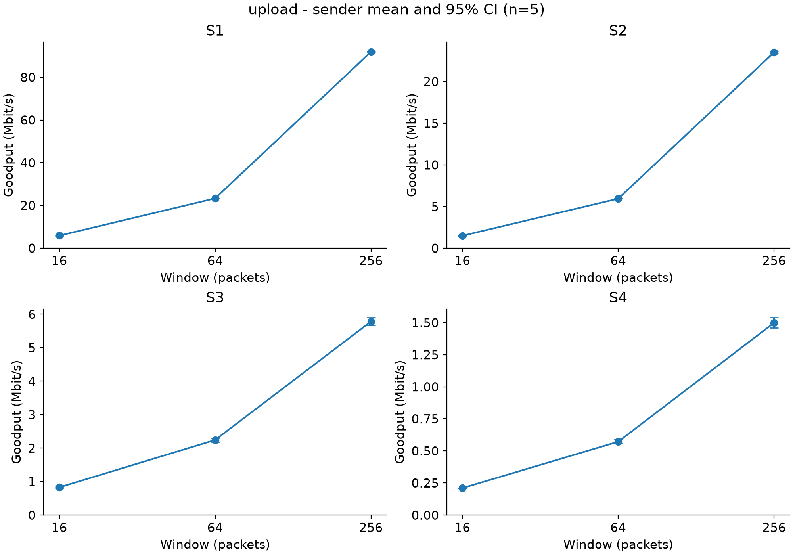

# Window comparison

Five repetitions per scenario/window; sender metrics, Student t intervals. These intervals do not establish significance or remove scheduling/machine effects. Confirm same machine and source revision manually; manifests record OS/Go but do not identify hardware or commit.

| Scenario | Operation | Window | Goodput Mbit/s | CI95 halfwidth |
|---|---|---:|---:|---:|
| S1 | download | 16 | 5.8280 | 0.0184 |
| S1 | download | 64 | 23.2777 | 0.0345 |
| S1 | download | 256 | 91.9217 | 0.2827 |
| S1 | upload | 16 | 5.8457 | 0.0151 |
| S1 | upload | 64 | 23.3184 | 0.0186 |
| S1 | upload | 256 | 91.9160 | 0.2073 |
| S2 | download | 16 | 1.4877 | 0.0029 |
| S2 | download | 64 | 5.9463 | 0.0008 |
| S2 | download | 256 | 23.5740 | 0.0225 |
| S2 | upload | 16 | 1.4876 | 0.0029 |
| S2 | upload | 64 | 5.9464 | 0.0018 |
| S2 | upload | 256 | 23.5199 | 0.1079 |
| S3 | download | 16 | 0.8270 | 0.0075 |
| S3 | download | 64 | 2.2097 | 0.0857 |
| S3 | download | 256 | 6.0745 | 0.1380 |
| S3 | upload | 16 | 0.8260 | 0.0136 |
| S3 | upload | 64 | 2.2430 | 0.0571 |
| S3 | upload | 256 | 5.7803 | 0.1178 |
| S4 | download | 16 | 0.2112 | 0.0020 |
| S4 | download | 64 | 0.5684 | 0.0085 |
| S4 | download | 256 | 1.5489 | 0.0593 |
| S4 | upload | 16 | 0.2098 | 0.0025 |
| S4 | upload | 64 | 0.5721 | 0.0149 |
| S4 | upload | 256 | 1.4986 | 0.0404 |

