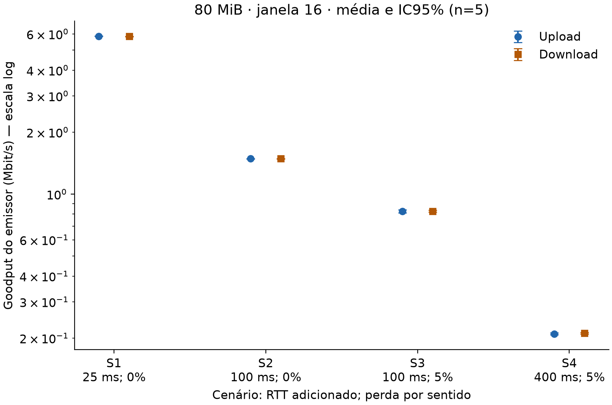
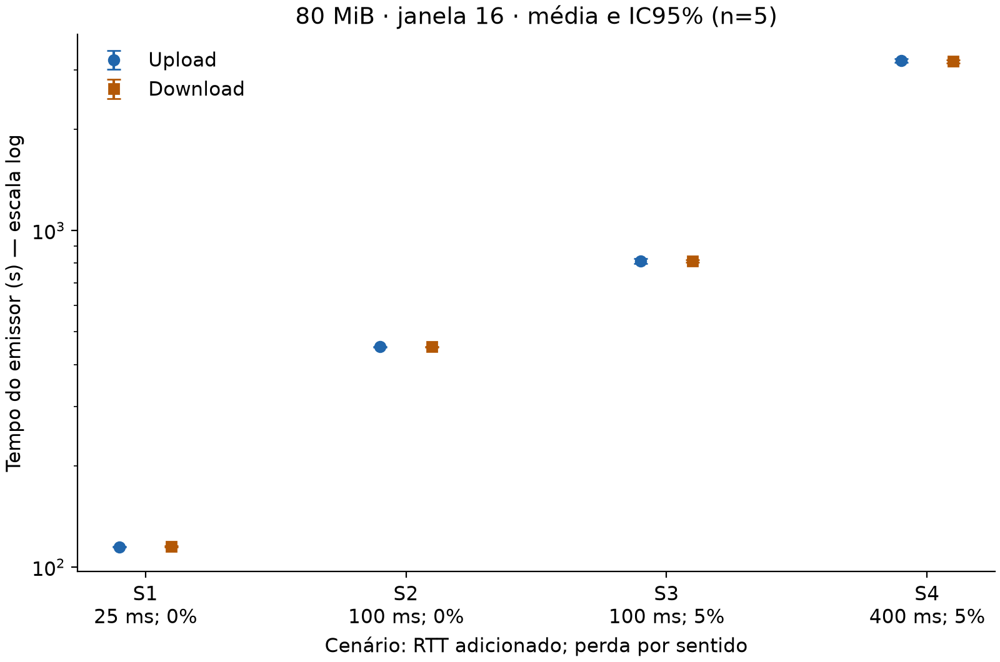
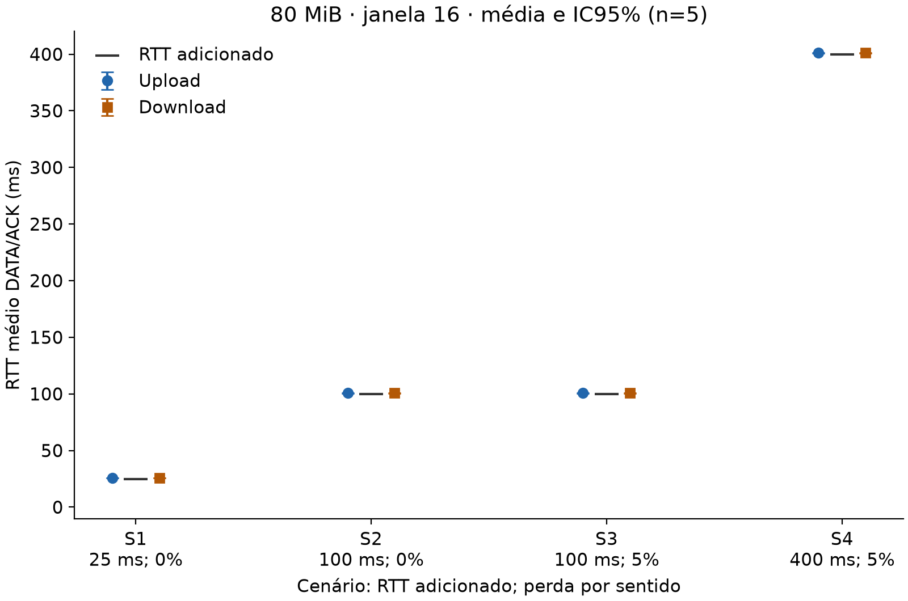
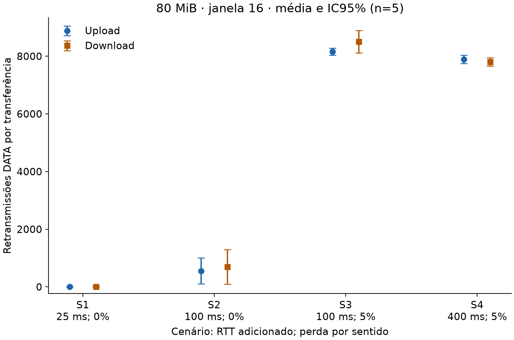

# Campanha da etapa 4 — janelas 16

Origem: `etapa4-774158857`; 80 MiB por transferência; windows/amd64, go1.27.4.

Validação: 80 registros, 40 sessões pareadas, 20 pares upload/download. Todos com sucesso, tamanho e SHA-256 iguais ao manifesto. CSV e JSONL conferidos; zero descartes por fila cheia e zero erros de envio no emulador.

SHA-256 dos arquivos transferidos: `42d12a7bb4fe5161f36dd20908f31ea01e2ae86741f32adc970dc527f22ad4f4`.

## Métricas do emissor

Médias de cinco repetições. Goodput: média ± semiamplitude do IC95% t de Student (4 graus de liberdade). O intervalo pressupõe repetições independentes e distribuição aproximadamente normal; não cobre erro sistemático da emulação. RTT é a média das médias de cada execução, com Karn. Os tempos de download abaixo são do servidor emissor, diferentes dos tempos de receptor mostrados no terminal.

| Cenário | Operação | Tempo (s) | Goodput ± IC95% (Mbit/s) | RTT (ms) | Retransmissões (média) | RC2 oferecido (Mbit/s) |
|---|---|---:|---:|---:|---:|---:|
| S1 | upload | 114.802 | 5.8457 ± 0.0151 | 25.646 | 0.0 | 5.9853 |
| S1 | download | 115.149 | 5.8280 ± 0.0184 | 25.709 | 7.6 | 5.9679 |
| S2 | upload | 451.114 | 1.4876 ± 0.0029 | 100.773 | 554.0 | 1.5350 |
| S2 | download | 451.078 | 1.4877 ± 0.0029 | 100.764 | 691.6 | 1.5380 |
| S3 | upload | 812.621 | 0.8260 ± 0.0136 | 100.761 | 8158.8 | 0.9421 |
| S3 | download | 811.498 | 0.8270 ± 0.0075 | 100.734 | 8502.4 | 0.9474 |
| S4 | upload | 3198.242 | 0.2098 ± 0.0025 | 401.145 | 7889.4 | 0.2385 |
| S4 | download | 3177.690 | 0.2112 ± 0.0020 | 401.137 | 7801.2 | 0.2398 |

RC2 oferecido inclui cabeçalho do protocolo e retransmissões; exclui UDP/IP/Ethernet e comandos de serviço. Não é throughput capturado no fio.

## Emulador

Taxa observada ponderada: soma dos descartes sorteados / soma dos datagramas vistos. Inclui dados, ACKs e controle nos dois sentidos durante upload e download, não uma taxa separada por operação.

| Cenário | Cliente → servidor | Servidor → cliente | Pendentes/cancelados (total) |
|---|---:|---:|---:|
| S1 | 0.0000% | 0.0000% | 0 |
| S2 | 0.0000% | 0.0000% | 0 |
| S3 | 5.0128% | 5.0335% | 0 |
| S4 | 5.0276% | 4.9852% | 0 |

## Interpretação e limites

S1/S2 isolam o aumento do atraso sem perda sorteada; S2/S3 isolam a adição de perda com o mesmo RTT configurado; S3/S4 aumentam o atraso mantendo a probabilidade de perda. Retransmissões em cenário sem perda sorteada não provam perda no enlace: timeouts prematuros, agendamento e perdas fora do emulador exigem investigação própria.

Esta campanha valida as janelas registradas no manifesto, um arquivo e um ambiente. Atrasos são adicionados ao loopback, não medidos entre máquinas. Não foi feita inferência causal sobre cada retransmissão nem teste de significância entre cenários. Esta campanha integra a comparação entre janelas; consulte comparison.md no diretório superior. Captura S3 documentada separadamente; mini-CDN é outra etapa.

## Proveniência dos dados

- `manifest.json`: `d524f8d2ebb5bebcf8c33a6f229821a74fb215f05b49797ecdfa25f564680d53`
- `metrics.jsonl`: `a79335b8ffd7b99a44e878a72c8e49f53f902c1b52b7658bd3a7871bd858a3ba`
- `metrics.csv`: `5c40e8cf2396aa79df7b0d989811eee86770355c1c1511fdc066f5458b984349`
- `emulation.jsonl`: `c7b5f3c93f4db263dd7985b13efc86fa4d49e1aa77fa697cc2970a1482ab9d61`
- `COMPLETE`: `4d9bca1012bfa0f16554bea8c78735aa23219e04e3f926803681c361dff29367`

## Gráficos

Barras: IC95% t de Student entre cinco repetições; métricas do emissor nas duas operações. RTT usa apenas amostras sem retransmissão (Karn). Os gráficos de goodput e tempo usam escala logarítmica. Arquivos PDF de mesmo nome também estão disponíveis.

