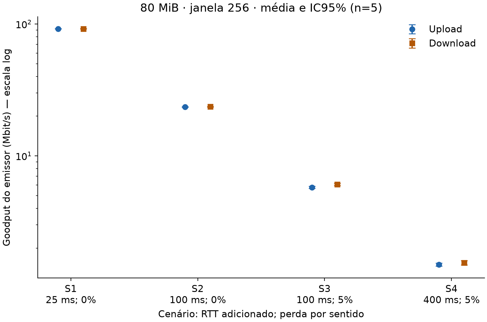
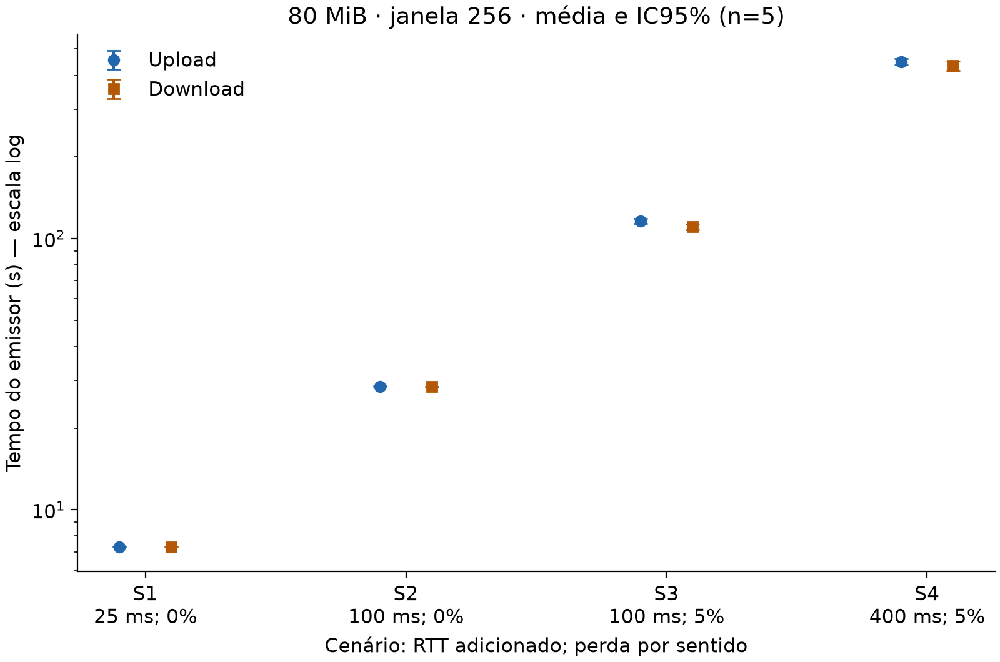
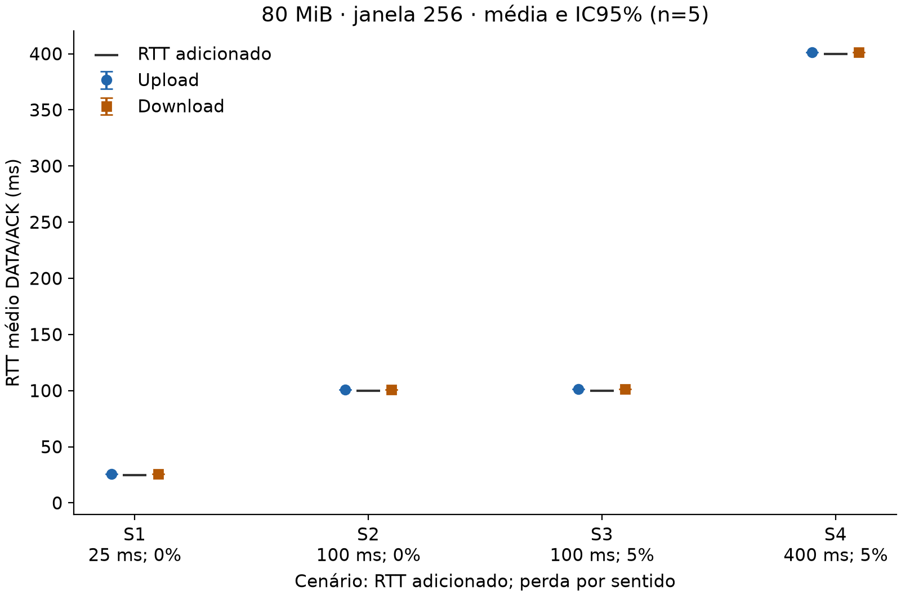
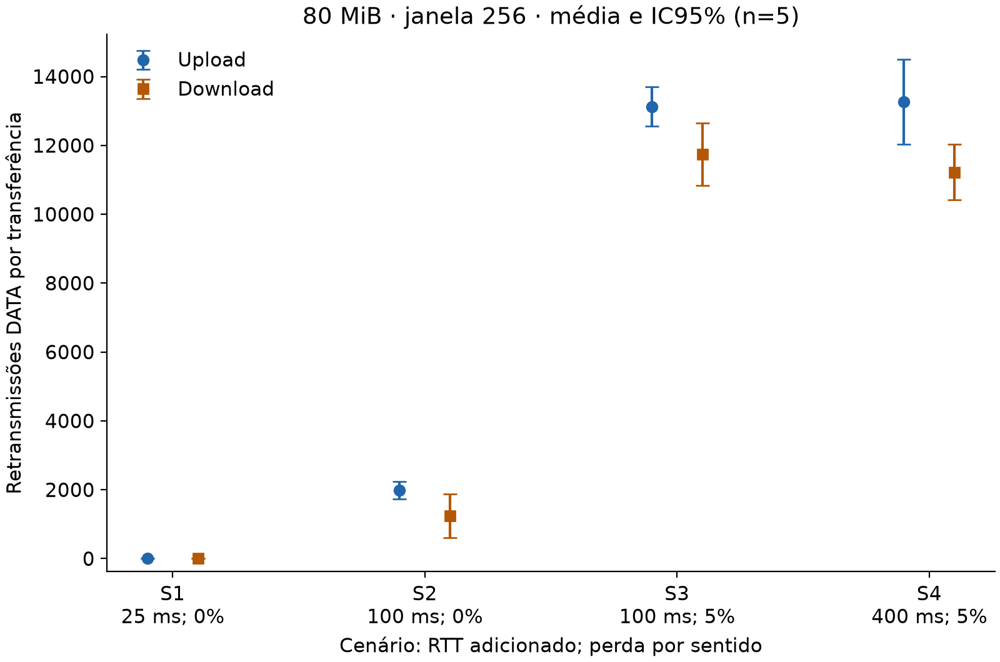

# Campanha da etapa 4 — janelas 256

Origem: `etapa4-751041340`; 80 MiB por transferência; windows/amd64, go1.27.4.

Validação: 80 registros, 40 sessões pareadas, 20 pares upload/download. Todos com sucesso, tamanho e SHA-256 iguais ao manifesto. CSV e JSONL conferidos; zero descartes por fila cheia e zero erros de envio no emulador.

SHA-256 dos arquivos transferidos: `42d12a7bb4fe5161f36dd20908f31ea01e2ae86741f32adc970dc527f22ad4f4`.

## Métricas do emissor

Médias de cinco repetições. Goodput: média ± semiamplitude do IC95% t de Student (4 graus de liberdade). O intervalo pressupõe repetições independentes e distribuição aproximadamente normal; não cobre erro sistemático da emulação. RTT é a média das médias de cada execução, com Karn. Os tempos de download abaixo são do servidor emissor, diferentes dos tempos de receptor mostrados no terminal.

| Cenário | Operação | Tempo (s) | Goodput ± IC95% (Mbit/s) | RTT (ms) | Retransmissões (média) | RC2 oferecido (Mbit/s) |
|---|---|---:|---:|---:|---:|---:|
| S1 | upload | 7.301 | 91.9160 ± 0.2073 | 25.820 | 0.0 | 94.1122 |
| S1 | download | 7.301 | 91.9217 ± 0.2827 | 25.844 | 0.0 | 94.1180 |
| S2 | upload | 28.533 | 23.5199 ± 0.1079 | 100.964 | 1982.8 | 24.7490 |
| S2 | download | 28.467 | 23.5740 ± 0.0225 | 100.871 | 1247.2 | 24.5578 |
| S3 | upload | 116.126 | 5.7803 ± 0.1178 | 101.311 | 13127.6 | 7.0042 |
| S3 | download | 110.506 | 6.0745 ± 0.1380 | 101.244 | 11743.6 | 7.2395 |
| S4 | upload | 447.977 | 1.4986 ± 0.0404 | 401.479 | 13265.6 | 1.8188 |
| S4 | download | 433.613 | 1.5489 ± 0.0593 | 401.481 | 11225.6 | 1.8344 |

RC2 oferecido inclui cabeçalho do protocolo e retransmissões; exclui UDP/IP/Ethernet e comandos de serviço. Não é throughput capturado no fio.

## Emulador

Taxa observada ponderada: soma dos descartes sorteados / soma dos datagramas vistos. Inclui dados, ACKs e controle nos dois sentidos durante upload e download, não uma taxa separada por operação.

| Cenário | Cliente → servidor | Servidor → cliente | Pendentes/cancelados (total) |
|---|---:|---:|---:|
| S1 | 0.0000% | 0.0000% | 0 |
| S2 | 0.0000% | 0.0000% | 0 |
| S3 | 5.0173% | 5.0348% | 0 |
| S4 | 5.0272% | 4.9873% | 0 |

## Interpretação e limites

S1/S2 isolam o aumento do atraso sem perda sorteada; S2/S3 isolam a adição de perda com o mesmo RTT configurado; S3/S4 aumentam o atraso mantendo a probabilidade de perda. Retransmissões em cenário sem perda sorteada não provam perda no enlace: timeouts prematuros, agendamento e perdas fora do emulador exigem investigação própria.

Esta campanha valida as janelas registradas no manifesto, um arquivo e um ambiente. Atrasos são adicionados ao loopback, não medidos entre máquinas. Não foi feita inferência causal sobre cada retransmissão nem teste de significância entre cenários. Esta campanha integra a comparação entre janelas; consulte comparison.md no diretório superior. Captura S3 documentada separadamente; mini-CDN é outra etapa.

## Proveniência dos dados

- `manifest.json`: `79b11ec6c4f5d859fffbad8c5a5a5958f6373c8c55618e649a518ef0f8216045`
- `metrics.jsonl`: `145870012f3b9396872134872de64eea3eabd38011b1c76174cb781ff0b100e8`
- `metrics.csv`: `403349d5e758755d2c54d230db6782435aeb83dfbf5e06fa353765280557b4d9`
- `emulation.jsonl`: `15bce91924b9369f11fffbca768ebb2ede107bb4a06a73e60606d25a6fc94d83`
- `COMPLETE`: `4d9bca1012bfa0f16554bea8c78735aa23219e04e3f926803681c361dff29367`

## Gráficos

Barras: IC95% t de Student entre cinco repetições; métricas do emissor nas duas operações. RTT usa apenas amostras sem retransmissão (Karn). Os gráficos de goodput e tempo usam escala logarítmica. Arquivos PDF de mesmo nome também estão disponíveis.

