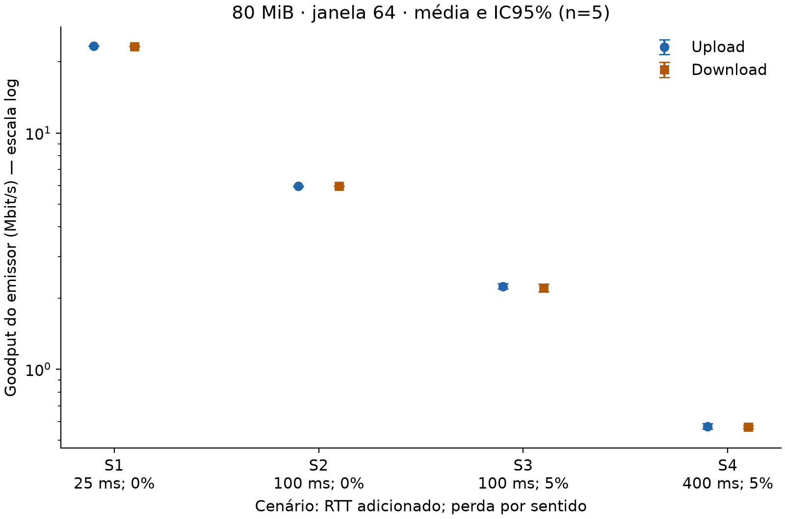
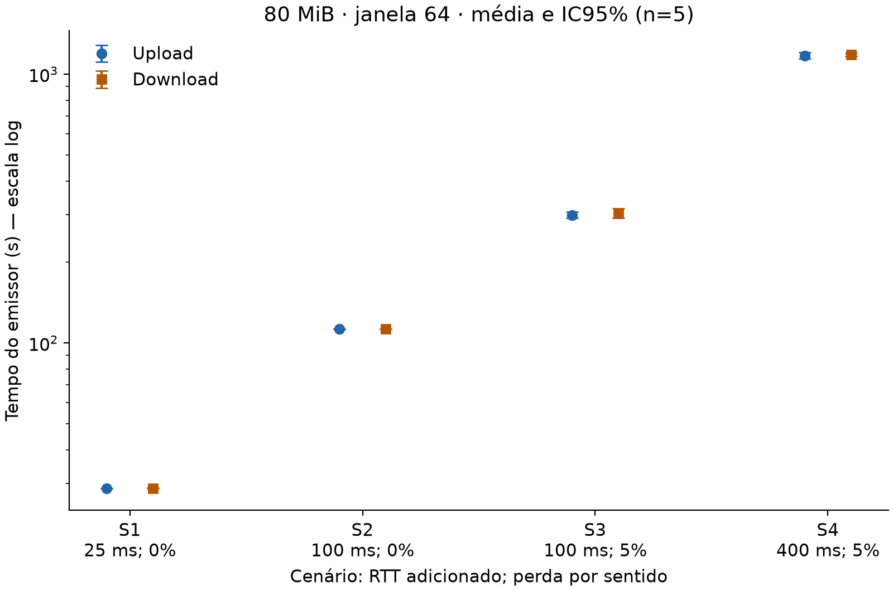
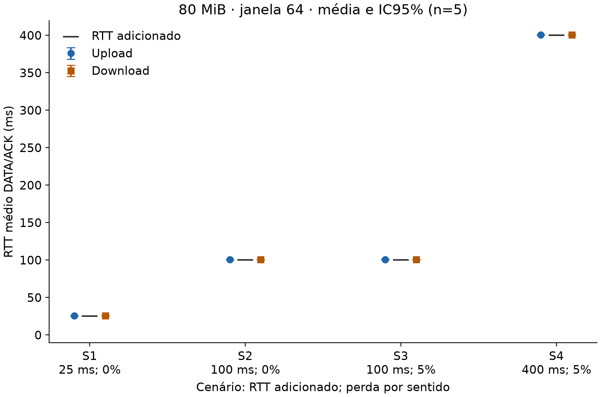
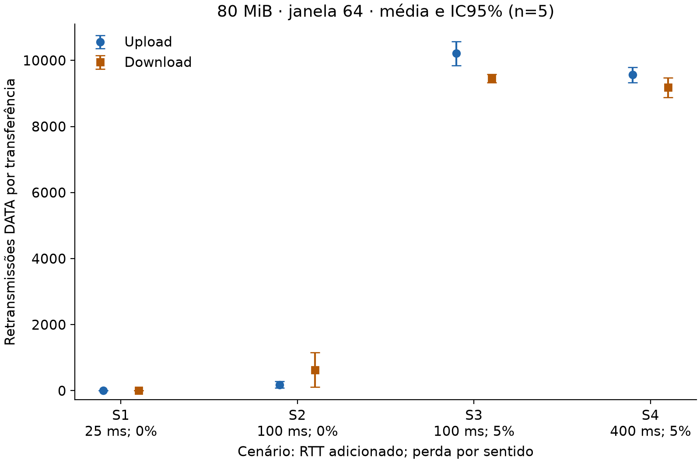

# Campanha da etapa 4 — janelas 64

Origem: `etapa4-1490099931`; 80 MiB por transferência; windows/amd64, go1.27.4.

Validação: 80 registros, 40 sessões pareadas, 20 pares upload/download. Todos com sucesso, tamanho e SHA-256 iguais ao manifesto. CSV e JSONL conferidos; zero descartes por fila cheia e zero erros de envio no emulador.

SHA-256 dos arquivos transferidos: `42d12a7bb4fe5161f36dd20908f31ea01e2ae86741f32adc970dc527f22ad4f4`.

## Métricas do emissor

Médias de cinco repetições. Goodput: média ± semiamplitude do IC95% t de Student (4 graus de liberdade). O intervalo pressupõe repetições independentes e distribuição aproximadamente normal; não cobre erro sistemático da emulação. RTT é a média das médias de cada execução, com Karn. Os tempos de download abaixo são do servidor emissor, diferentes dos tempos de receptor mostrados no terminal.

| Cenário | Operação | Tempo (s) | Goodput ± IC95% (Mbit/s) | RTT (ms) | Retransmissões (média) | RC2 oferecido (Mbit/s) |
|---|---|---:|---:|---:|---:|---:|
| S1 | upload | 28.779 | 23.3184 ± 0.0186 | 25.664 | 0.0 | 23.8756 |
| S1 | download | 28.830 | 23.2777 ± 0.0345 | 25.708 | 0.0 | 23.8339 |
| S2 | upload | 112.855 | 5.9464 ± 0.0018 | 100.663 | 183.6 | 6.1041 |
| S2 | download | 112.858 | 5.9463 ± 0.0008 | 100.657 | 632.4 | 6.1422 |
| S3 | upload | 299.294 | 2.2430 ± 0.0571 | 100.840 | 10211.6 | 2.6241 |
| S3 | download | 303.939 | 2.2097 ± 0.0857 | 100.748 | 9457.6 | 2.5614 |
| S4 | upload | 1173.486 | 0.5721 ± 0.0149 | 400.863 | 9562.8 | 0.6640 |
| S4 | download | 1180.833 | 0.5684 ± 0.0085 | 400.818 | 9179.2 | 0.6566 |

RC2 oferecido inclui cabeçalho do protocolo e retransmissões; exclui UDP/IP/Ethernet e comandos de serviço. Não é throughput capturado no fio.

## Emulador

Taxa observada ponderada: soma dos descartes sorteados / soma dos datagramas vistos. Inclui dados, ACKs e controle nos dois sentidos durante upload e download, não uma taxa separada por operação.

| Cenário | Cliente → servidor | Servidor → cliente | Pendentes/cancelados (total) |
|---|---:|---:|---:|
| S1 | 0.0000% | 0.0000% | 0 |
| S2 | 0.0000% | 0.0000% | 0 |
| S3 | 5.0176% | 5.0370% | 0 |
| S4 | 5.0306% | 4.9849% | 0 |

## Interpretação e limites

S1/S2 isolam o aumento do atraso sem perda sorteada; S2/S3 isolam a adição de perda com o mesmo RTT configurado; S3/S4 aumentam o atraso mantendo a probabilidade de perda. Retransmissões em cenário sem perda sorteada não provam perda no enlace: timeouts prematuros, agendamento e perdas fora do emulador exigem investigação própria.

Esta campanha valida uma janela (64), arquivo e ambiente. Atrasos são adicionados ao loopback, não medidos entre máquinas. Não foi feita inferência causal sobre cada retransmissão nem teste de significância entre cenários. Ainda faltam variação de janela e capturas Wireshark; mini-CDN é outra etapa.

## Proveniência dos dados

- `manifest.json`: `02ea1d1147e46b34ada7701c24aa565f45a1d16922c51ebc3d4252c6bb80c5e7`
- `metrics.jsonl`: `2978fb231c8bd5bbeae8b0770ffaa7b7d1afe9382cafd8d9ee513aa94a555fed`
- `metrics.csv`: `097a517609566e2e29d05eff62c03478277a3a13286820744f53cdc001e17172`
- `emulation.jsonl`: `0d87333a47a07e4b24c20defdca1348479b52206439e5dea7282b3e56ad35195`
- `COMPLETE`: `4d9bca1012bfa0f16554bea8c78735aa23219e04e3f926803681c361dff29367`

## Gráficos

Barras: IC95% t de Student entre cinco repetições; métricas do emissor nas duas operações. RTT usa apenas amostras sem retransmissão (Karn). Os gráficos de goodput e tempo usam escala logarítmica. Arquivos PDF de mesmo nome também estão disponíveis.

